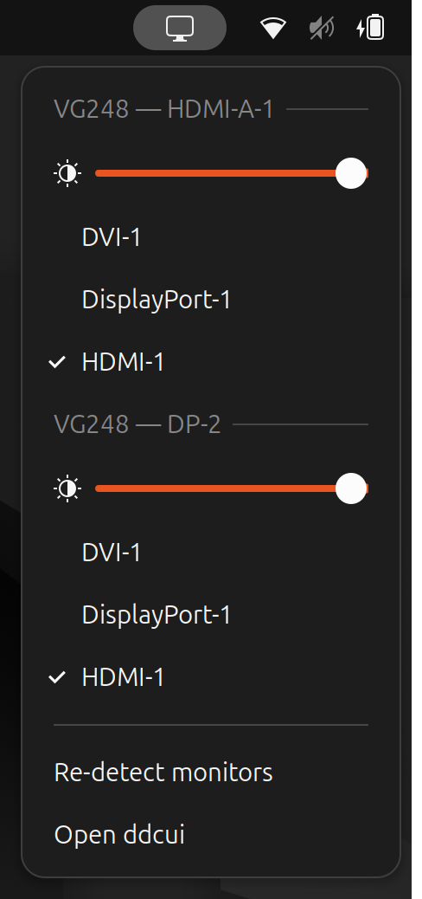

# Monitor Input & Brightness

<p align="center"></p>

Switch the **input source** and set the **brightness** of your external monitors from the GNOME top bar.

## Install

```sh
curl -fsSL https://raw.githubusercontent.com/cezou/monitor-input-brightness/main/install.sh | bash
```

Then log out and back in.

## Requirements

- GNOME Shell 46–48
- Monitors with DDC/CI enabled (usually on by default, otherwise in the monitor's OSD menu)

The script installs [`ddcutil`](https://www.ddcutil.com/) and sets up I²C access if needed.

## License

GPL-2.0-or-later
